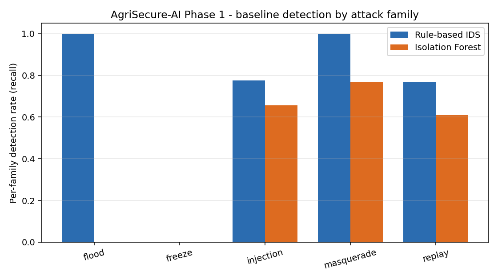

# AgriSecure-AI

Embedded AI cybersecurity for CAN / SAE J1939 agricultural vehicle networks.

AgriSecure-AI is a design for real-time, on-board intrusion detection on the
communication networks of autonomous and driver-assisted agricultural machinery,
intended to run inside resource-constrained electronic control units and to meet
functional-safety (ISO 26262) and cybersecurity (ISO/SAE 21434) expectations
together. This repository holds the Phase 1 evaluation groundwork.

## Phase 1 — done in software

Phase 1 delivers a threat model, a labelled dataset, and baseline detection
results. It runs entirely in software on one PC; no vehicle, no physical bus, and
no action against any real system are involved. Hardware-in-the-loop validation is
the one Phase 1 item that needs hardware and remains open.

- **Threat model**: `docs/THREAT_MODEL.md` — ISO/SAE 21434-style analysis of a
  tractor J1939 / ISOBUS network and five attack families.
- **Dataset**: `docs/DATASET_DATASHEET.md` — real Tümosan tractor signals
  (CC BY 4.0) reconstructed into a standards-conformant J1939 frame stream, with
  seeded, labelled anomaly scenarios. The first public agricultural J1939 dataset
  with labelled attacks.
- **Baseline detection**: `scripts/detect_baseline.py` — a lightweight rule-based
  IDS and an Isolation Forest, evaluated on held-out attacked data.
- **Full write-up**: `REPORT.md`.

### Headline result

A rule-based detector trained only on attack-free traffic reaches F1 0.935 at a
0.05 % false-positive rate, detecting flood, injection, and masquerade attacks
within about a millisecond and most replay attacks within about 44 ms. Stuck-value
(freeze) attacks are an honest, documented blind spot that motivates Phase 2.



## Layout

```
AVAILABILITY.md            data sources, licences, tooling check
REPORT.md                  Phase 1 report
docs/THREAT_MODEL.md       ISO/SAE 21434-style threat analysis
docs/DATASET_DATASHEET.md  dataset provenance, schema, licence
scripts/common.py          J1939 PGN/SPN mapping, packing, loaders
scripts/build_can_stream.py   real signals -> J1939 frame stream
scripts/inject_anomalies.py   seeded, labelled attack injection
scripts/detect_baseline.py    rule-based + Isolation Forest, metrics
dataset/                   reconstructed + attacked frames (large files untracked)
results/                   metrics.json, figures
```

## Running it

```bash
# Python 3.9, Windows. Create the environment once:
"/c/Program Files/Python39/python.exe" -m venv .venv
.venv/Scripts/python.exe -m pip install python-can cantools pandas numpy scikit-learn matplotlib pyarrow rarfile

# Fetch the real tractor data (CC BY 4.0) into data/tumosan_raw/, then:
.venv/Scripts/python.exe -I scripts/build_can_stream.py
.venv/Scripts/python.exe -I scripts/inject_anomalies.py
.venv/Scripts/python.exe -I scripts/detect_baseline.py
```

The raw tractor archive is not committed; `AVAILABILITY.md` has its source and
licence. The dataset released here is CC BY 4.0; attribute this project and the
Tümosan source (DOI 10.17632/bbjtjrsxvx.2).

## Scope and honesty

Normal traffic content is real tractor data. The J1939 frame layer is a documented,
lossless reconstruction from the published decoded signals, not a claim of
byte-identical OEM frames. All attacks are simulated on that reconstructed stream;
nothing here targets a real device or network. Results are reported as measured,
including the family the baseline fails to detect.
