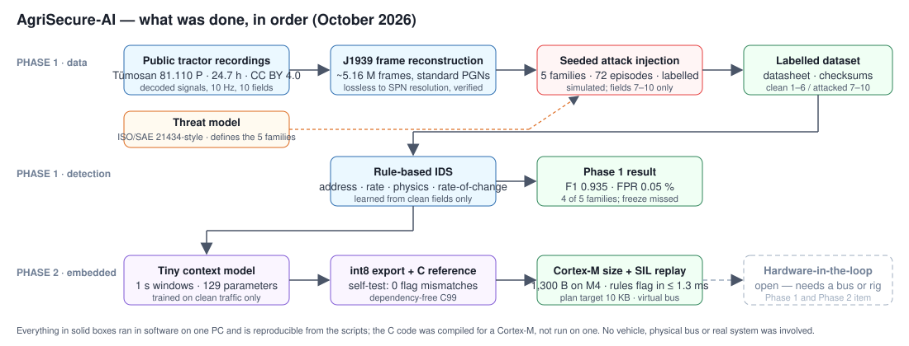
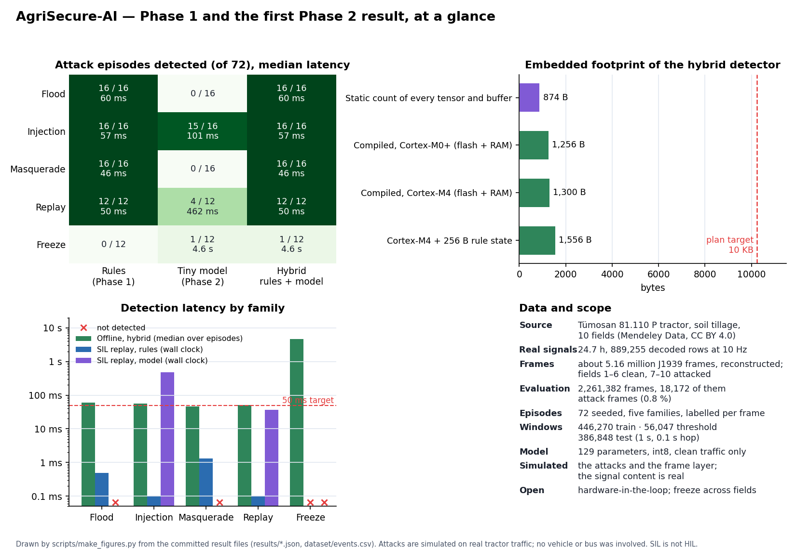
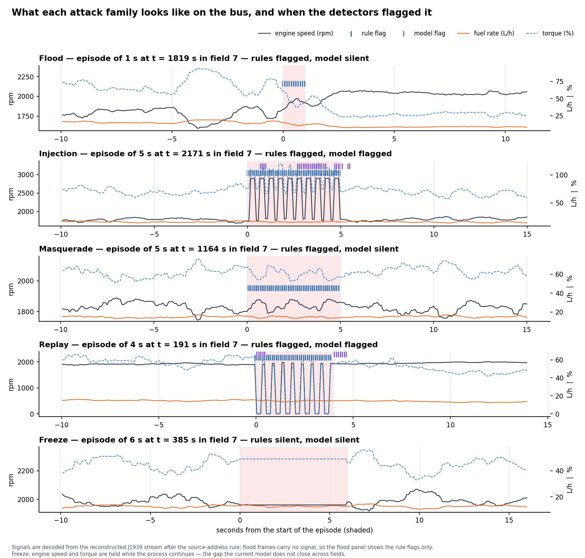
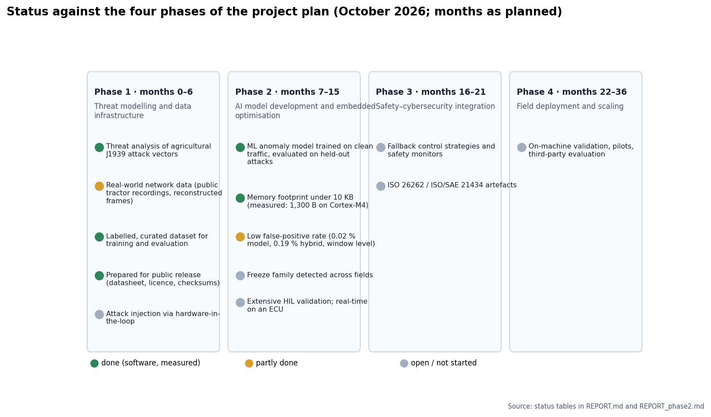

# AgriSecure-AI

Embedded intrusion detection for the CAN / SAE J1939 networks of agricultural
machinery. Tractors and implements talk over a bus with no authentication, so a
device on that bus can forge engine, speed or implement messages. AgriSecure-AI
is a detector meant to run inside the machine's own small controllers, with no
cloud, and to hand off to the machine's safety logic. This repository holds the
work so far: Phase 1 of the project plan in software, and the first Phase 2
result.

**In five lines.** Real tractor signals from a public dataset were rebuilt into a
standards-conformant J1939 frame stream. Five families of attacks were injected
in simulation and labelled frame by frame. A rule-based detector learned from
clean traffic catches four of the five families; a 129-parameter model adds
detection inside those attacks. The whole detector compiles to 1,300 bytes on a
Cortex-M4 microcontroller, against the plan's 10 KB target. The fifth family,
a frozen sensor value, is still not caught across fields, and hardware-in-the-
loop validation has not been done.

## The process



## The outcomes, at a glance







## Where to look

| If you want to know… | Read |
| --- | --- |
| The whole story on two pages, for a non-specialist | `docs/OVERVIEW.md` |
| What was threatened and why those five attack families | `docs/THREAT_MODEL.md` |
| Where the data comes from, what is real and what is simulated, licence, checksums | `docs/DATASET_DATASHEET.md` |
| Phase 1 method and results, with the family the baseline misses | `REPORT.md` |
| Phase 2 model, footprint, SIL replay, and why freeze is still open | `REPORT_phase2.md` |
| Every number behind the figures | `results/metrics.json`, `results/metrics_phase2.json`, `results/footprint_phase2.json`, `results/sil_phase2.json` |
| The compiler's own output for the footprint | `results/embedded_build_phase2.txt` |
| Which public datasets were checked for the gap this one fills | `AVAILABILITY.md` |
| What has been promised and what has not | the status tables at the end of both reports, and `docs/figures`' phase status |

## Phase 1 — software groundwork

Phase 1 delivers a threat model, a labelled dataset, and baseline detection
results. It runs entirely in software on one PC; no vehicle, no physical bus, and
no action against any real system are involved. Hardware-in-the-loop validation is
the one Phase 1 item that needs hardware and remains open.

- **Threat model**: `docs/THREAT_MODEL.md` — ISO/SAE 21434-style analysis of a
  tractor J1939 / ISOBUS network and five attack families.
- **Dataset**: `docs/DATASET_DATASHEET.md` — real Tümosan tractor signals
  (CC BY 4.0) reconstructed into a standards-conformant J1939 frame stream, with
  seeded, labelled anomaly scenarios. We found no public dataset of agricultural
  J1939 traffic with labelled attacks as of October 2026; the sources checked are
  listed in `AVAILABILITY.md`.
- **Baseline detection**: `scripts/detect_baseline.py` — a lightweight rule-based
  IDS and an Isolation Forest, evaluated on held-out attacked data.
- **Full write-up**: `REPORT.md`.

A rule-based detector trained only on attack-free traffic reaches F1 0.935 at a
0.05 % false-positive rate, detecting flood, injection, and masquerade attacks
within about a millisecond and most replay attacks within about 44 ms. Stuck-value
(freeze) attacks are an honest, documented blind spot.

## Phase 2 — first result, started early on the Phase 1 data

A tiny context model (5 → 8 → 8 → 1, 129 parameters) trained on clean traffic,
quantised to int8, written out as a C header with a dependency-free C
reference, and run as a hybrid with the Phase 1 rules. The hybrid detector
compiles to **1,300 bytes on a Cortex-M4** (1,040 flash, 260 RAM; plus 256 B
of rule state), measured with the GNU Arm toolchain, against the plan's 10 KB
target; the C inference matches the Python model on the committed test vectors
with no flag disagreements. The model adds in-window detection for injection
and replay; freeze remains undetected across fields, for a measured reason
stated in the report. A software-in-the-loop replay over a virtual CAN bus
flags flood, injection, masquerade and replay within 0.1 to 1.3 ms on the wall
clock. Hardware-in-the-loop is still open. Full write-up: `REPORT_phase2.md`.

## Layout

```
AVAILABILITY.md            data sources, licences, tooling check
REPORT.md                  Phase 1 report
REPORT_phase2.md           Phase 2 first result: tiny model, int8 footprint, SIL
docs/OVERVIEW.md           two-page explainer for the non-specialist reader
docs/THREAT_MODEL.md       ISO/SAE 21434-style threat analysis
docs/DATASET_DATASHEET.md  dataset provenance, schema, licence, checksums
docs/figures/process.svg   the process diagram above
scripts/common.py          J1939 PGN/SPN mapping, packing, loaders
scripts/build_can_stream.py   real signals -> J1939 frame stream
scripts/inject_anomalies.py   seeded, labelled attack injection
scripts/detect_baseline.py    rule-based + Isolation Forest, metrics
scripts/train_tiny_model.py   Phase 2 window features, tiny models, hybrid evaluation
scripts/export_embedded.py    int8 export, C header, test vectors, footprint
scripts/sil_replay.py         software-in-the-loop replay over a virtual CAN bus
scripts/make_figures.py       the reader-facing figures, from the result files
embedded/tiny_ids.c        C99 reference detector (rules + model) with self-test
embedded/model_weights.h   generated int8 weights; embedded/test_vectors.h
dataset/                   events.csv + readable sample (parquet files untracked, see below)
results/                   metrics, footprint, SIL, build log, figures
LICENSE                    MIT for the code; the dataset is CC BY 4.0
CITATION.cff               how to cite
requirements.txt           pinned Python packages
```

## Running it

```bash
# Python 3.9, Windows. Create the environment once:
"/c/Program Files/Python39/python.exe" -m venv .venv
.venv/Scripts/python.exe -m pip install -r requirements.txt

# Fetch the real tractor data (CC BY 4.0) into data/tumosan_raw/, then:
.venv/Scripts/python.exe -I scripts/build_can_stream.py
.venv/Scripts/python.exe -I scripts/inject_anomalies.py
.venv/Scripts/python.exe -I scripts/detect_baseline.py

# Phase 2:
.venv/Scripts/python.exe -I scripts/train_tiny_model.py
.venv/Scripts/python.exe -I scripts/export_embedded.py
.venv/Scripts/python.exe -I scripts/sil_replay.py
.venv/Scripts/python.exe -I scripts/make_figures.py
# C reference (needs a compiler; commands in embedded/tiny_ids.c):
#   gcc -std=c99 -O2 -Wall -o tiny_ids embedded/tiny_ids.c -lm && ./tiny_ids
```

The raw tractor archive is not committed; `AVAILABILITY.md` has its source and
licence. The full parquet dataset (about 45 MB) is not in this repository either:
it is reproduced byte-for-byte by the three scripts above (the generator is
seeded), and it will be attached to the tagged release or deposited with a DOI;
until then it is available on request. `docs/DATASET_DATASHEET.md` lists the
SHA-256 of every parquet file so a copy can be checked against this commit. The
dataset is CC BY 4.0; attribute this project and the Tümosan source
(DOI 10.17632/bbjtjrsxvx.2). The code is MIT-licensed (`LICENSE`); cite with
`CITATION.cff`.

## Scope and honesty

Normal traffic content is real tractor data. The J1939 frame layer is a documented,
lossless reconstruction from the published decoded signals, not a claim of
byte-identical OEM frames. All attacks are simulated on that reconstructed stream;
nothing here targets a real device or network. The C code was compiled for a
Cortex-M, not run on one; the replay is software-in-the-loop, not hardware.
Results are reported as measured, including the family the detectors fail to
catch.
