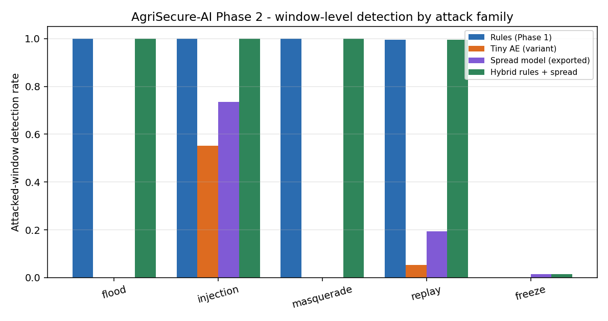

# AgriSecure-AI Phase 2, first result — tiny context model, int8 footprint, software-in-the-loop

Part of the AgriSecure-AI project.

## Summary

This is the first Phase 2 result, started early on the Phase 1 data. Phase 2 in
the project plan is machine-learning anomaly detection on CAN / SAE J1939
traffic, optimised to an embedded footprint under 10 KB, with hardware-in-the-loop
validation. This report covers the parts that can be done in software on one PC:

- A context model trained on clean traffic only, evaluated on the attacked
  fields alone and as a hybrid with the Phase 1 rules.
- The model quantised to int8, written out as a C header, run through a
  dependency-free C reference implementation, checked against the Python
  model, and cross-compiled for Cortex-M targets to measure flash and RAM.
- A software-in-the-loop (SIL) replay of attacked traffic over a virtual CAN
  bus at wall-clock rate, with the streaming hybrid detector measuring its own
  detection latency.

Headline measured results:

- **Footprint:** the whole hybrid detector compiles to **1,300 bytes on a
  Cortex-M4** (1,040 flash, 260 RAM) and 1,256 bytes on a Cortex-M0+, plus
  256 bytes of rule state. The static count of every tensor and buffer is
  874 bytes. The 10 KB target is met with a wide margin.
- **int8 fidelity:** the C inference matches the Python model on 64 test
  windows to 8.6e-6 absolute, 0.22 % relative, with no flag disagreements;
  across all 386,848 test windows the int8 and float flags agree on 99.995 %.
- **Detection:** the hybrid keeps the Phase 1 coverage (every flood, injection,
  masquerade and replay episode detected) and the model adds detection inside
  the window for injection (73 % of attacked windows) and replay (19 %) that
  the rules only catch at the boundary frames. **Freeze remains undetected
  across fields** at the 0.1 % false-positive target: 1 episode of 12, 1.5 % of
  freeze windows. The reason is measured and stated below.
- **SIL:** on the virtual bus the rules flag flood, injection, masquerade and
  replay within 0.1 to 1.3 ms of the first attack frame on the wall clock; the
  model adds a flag 37 ms into the replay episode and 483 ms into the injection
  episode; no false flags in the clean lead-in of any segment.

Nothing here touched a vehicle, a physical bus or any real system. Hardware-in-
the-loop validation and real-time performance under operational conditions
remain open; PC and SIL timings are not embedded measurements.

## What was built

| File | Purpose |
| --- | --- |
| `scripts/train_tiny_model.py` | Window features, two tiny models trained on clean fields 1–5, threshold on clean field 6, evaluation on attacked fields 7–10, hybrid with the Phase 1 rules, figure, `results/metrics_phase2.json`, `results/tiny_model.npz` |
| `scripts/export_embedded.py` | int8 quantisation, `embedded/model_weights.h`, `embedded/test_vectors.h`, int8-vs-float check, `results/footprint_phase2.json` |
| `embedded/tiny_ids.c` | C99 reference: streaming Phase 1 rules (`rule_state_t`), 1 s ring buffer, the 12 features, the int8 model, a self-test against the test vectors |
| `scripts/sil_replay.py` | Wall-clock replay over a python-can virtual bus with the streaming hybrid detector; `results/sil_phase2.json` |
| `results/embedded_build_phase2.txt` | Verbatim compiler output: self-test, Cortex-M4 and M0+ sizes, symbol table |

## Windows and features

The three engine-address broadcasts that carry the signals (EEC1: engine speed
and torque; LFE1: fuel rate; CCVS1: wheel speed) are resampled onto their 100 ms
grid, last value per cell. Frames the Phase 1 source-address rule rejects are
dropped first, as the hybrid pipeline would do; injected and replayed frames
carry the legitimate address and stay in. Windows are 1.0 s long with a 0.1 s
hop. Per signal: the mean, the log10 of the standard deviation plus 0.01 (so a
frozen signal reads −2), and the end-to-start change. Twelve features.

| Set | Windows |
| --- | --- |
| Training (clean fields 1–5) | 446,270 |
| Threshold (clean field 6) | 56,047 |
| Test (attacked fields 7–10) | 386,848, of which 3,642 contain attack frames |

A window counts as attacked if any frame of any PGN inside it is an attack
frame; episodes are at least 20 s apart, so a window holds one family.

## Models

Both are trained on clean traffic only, with scikit-learn, Adam, early stopping
on a 10 % validation split. The threshold of each is the 99.9 % quantile of its
score on the held-out clean field 6, declared in advance as a 0.1 % window
false-positive target.

| Model | Inputs → target | Layers | Parameters | Threshold |
| --- | --- | --- | --- | --- |
| **SPR**, spread-consistency (exported) | log spread of engine speed, torque, wheel speed; mean engine speed and torque → log spread of fuel rate | 5 → 8 → 8 → 1 | 129 | 6.522 (squared residual) |
| **AE**, autoencoder (variant) | all 12 → all 12 | 12 → 6 → 3 → 6 → 12 | 207 | 8.422 (mean squared error) |

SPR encodes one physical relation: on a governed diesel the fuel rate only
varies when the load varies, so a frozen engine-speed/torque payload under a
moving fuel rate is inconsistent. AE models the window as a whole.

## Results

Window level, attacked fields 7–10:

| Detector | Precision | Recall | F1 | FPR on clean windows |
| --- | --- | --- | --- | --- |
| Rules (Phase 1), per window | 0.812 | 0.771 | 0.791 | 0.170 % |
| SPR alone | 0.916 | 0.227 | 0.364 | 0.020 % |
| AE alone | 0.831 | 0.153 | 0.258 | 0.030 % |
| **Hybrid rules + SPR** | 0.795 | 0.775 | 0.785 | 0.189 % |
| Hybrid rules + AE | 0.791 | 0.771 | 0.781 | 0.194 % |

Fraction of attacked windows flagged, by family:

| Family | Windows | Rules | SPR | AE | Hybrid rules + SPR |
| --- | --- | --- | --- | --- | --- |
| Flood | 320 | 1.000 | 0.000 | 0.000 | 1.000 |
| Injection | 953 | 1.000 | 0.735 | 0.552 | 1.000 |
| Masquerade | 951 | 1.000 | 0.000 | 0.000 | 1.000 |
| Replay | 588 | 0.995 | 0.194 | 0.053 | 0.995 |
| Freeze | 830 | 0.000 | 0.015 | 0.000 | 0.015 |

Episode level (an episode is detected if any window ending inside it, up to 1 s
after it, is flagged; latency is the first flagged window end minus the episode
start, so it has 100 ms granularity):

| Family | Episodes | Rules | SPR | AE | Hybrid rules + SPR |
| --- | --- | --- | --- | --- | --- |
| Flood | 16 | 16, 60 ms | 0 | 0 | 16, 60 ms |
| Injection | 16 | 16, 57 ms | 15, 101 ms | 16, 82 ms | 16, 57 ms |
| Masquerade | 16 | 16, 46 ms | 0 | 0 | 16, 46 ms |
| Replay | 12 | 12, 51 ms | 4, 462 ms | 2, 80 ms | 12, 51 ms |
| Freeze | 12 | 0 | 1, 4.6 s | 0 | 1, 4.6 s |

Two accounting differences from the Phase 1 report, so the numbers are not
compared one to one: Phase 1 counted flagged *attack frames*, this report
counts any flagged frame in the window, including a legitimate frame the rules
flag because a replayed frame displaced it (that is why replay reads 12 of 12
here and 10 of 12 there); and latencies here are window ends on a 100 ms grid,
not frame times.



## Embedded footprint

Quantisation: int8 symmetric weights with one scale per tensor; biases,
normalisation, activations and threshold in float32. On the same test windows
the int8 model gives precision 0.920, recall 0.231, FPR 0.019 % against
0.916 / 0.227 / 0.020 % for the float model; the two flag the same window in
99.995 % of cases.

Static byte count from the exported tensors and the C layout
(`results/footprint_phase2.json`):

| Item | Bytes |
| --- | --- |
| Weights, int8 | 112 |
| Biases and per-tensor scales, float32 | 80 |
| Input index table | 20 |
| Feature mean, scale and threshold, float32 | 100 |
| Two activation buffers, float32 | 96 |
| 1 s ring buffer, 4 signals at 100 ms | 162 |
| Feature vector | 48 |
| Phase 1 rule state, 8 PGNs × 32 B | 256 |
| **Total** | **874** |

Compiled sizes (`results/embedded_build_phase2.txt`, GNU Arm Embedded 13.2,
`-Os`, no self-test main):

| Target | text (flash) | data | bss (RAM) | Total |
| --- | --- | --- | --- | --- |
| Cortex-M4 | 1,040 | 0 | 260 | 1,300 |
| Cortex-M0+ | 996 | 0 | 260 | 1,256 |

The rule-state array is not referenced inside the object and was dropped by
the compiler; adding its 256 bytes gives about 1.56 KB for the whole hybrid
detector. The C self-test, compiled with gcc on x86-64, scored the 64 test
vectors to within 8.6e-6 absolute and 0.22 % relative of the Python export
with zero flag mismatches.

What this is not: the code was compiled for, not run on, a Cortex-M. No cycle
count, no interrupt load, no bus driver. Per-frame processing in the Python
streaming mirror was 100 to 156 µs on this PC, which says nothing about an
ECU.

## Software-in-the-loop replay

`scripts/sil_replay.py` replays, for each family, the first episode of field 7
from 20 s before it to 10 s after it over a python-can virtual bus at
wall-clock rate, and runs the streaming hybrid detector (the Python mirror of
`tiny_ids.c`) on each frame as it arrives. Latency is wall clock: first flag
minus the send time of the first attack frame.

| Family | Frames | Attack frames | Rules latency | Model latency | False flags before the attack |
| --- | --- | --- | --- | --- | --- |
| Flood | 2,706 | 908 | 0.5 ms | — | 0 |
| Injection | 2,131 | 101 | 0.1 ms | 483 ms | 0 |
| Masquerade | 2,080 | 50 | 1.3 ms | — | 0 |
| Replay | 2,012 | 40 | 0.1 ms | 37 ms | 0 |
| Freeze | 2,088 | 60 | — | — | 0 |

This is SIL, not HIL: a virtual bus in one process, with no arbitration, no bus
load and no physical timing.

## Reading the results honestly

- **The footprint claim is the solid result.** Everything the hybrid detector
  needs fits in about 1.3 KB of flash and RAM on a Cortex-M4, measured by the
  toolchain, with the int8 model verified against the float one. The 10 KB
  target of the plan is met by a factor of six or more.
- **Freeze is still open, and now we know why.** In clean traffic, engine speed
  and torque are exactly constant only with the engine off, when fuel rate is
  flat too; in a freeze window they are frozen near 1,950 rpm while fuel keeps
  moving. Within one field this is separable: an exploratory fit of the same
  spread model on the test fields' own clean windows, with the threshold from
  those same fields, flagged 64 % of freeze windows at a 0.1 % false-positive
  rate. That is a diagnostic, not a result, because it uses test-field data for
  training. Across fields it does not transfer: the fuel-to-load relation shifts
  between fields (different tillage conditions), the clean residuals on the test
  fields are broad, and the threshold set on field 6 (6.52) is almost twice the
  test fields' own 99.9 % quantile (3.48). Even at the test fields' own
  quantile the model would flag 5.8 % of freeze windows, and 27 % at a 1 %
  false-positive rate. One-second windows and a single tractor in one operation
  are the limits. Longer context, per-field adaptation, or a payload-level
  consistency check are the next steps; none is claimed here.
- **The model adds depth inside injection and replay episodes, not new
  coverage.** The rules already catch every one of those episodes at the first
  anomalous frame; the model's value is flagging the frames in the middle of a
  burst that sit inside the physical envelope, which matters for sustained
  attacks and for confirming a detection.
- **The autoencoder is the weaker variant here.** It sees a frozen signal (its
  engine-speed spread error is 50 times the clean level) but the score is
  averaged across twelve features and the clean tail is heavy, so only 39 % of
  freeze windows clear its threshold in the diagnostic and none in the
  protocol. It is kept as the traffic-pattern baseline.
- **The pre-declared threshold protocol was kept.** Field 6 turned out
  conservative for the test fields (model false-positive rate 0.02 % against
  the 0.1 % target). Lowering the threshold after seeing the test results would
  have raised freeze recall, and was not done.
- **The attacks are simulated and the training data is one tractor.** The
  model has only ever seen the Phase 1 generator's five families on one machine
  in tillage. Anything about other machines, operations or attacks is
  extrapolation.

## Reproducing

```
.venv/Scripts/python.exe -I scripts/train_tiny_model.py   # ~7 min on this PC
.venv/Scripts/python.exe -I scripts/export_embedded.py    # header, vectors, footprint
.venv/Scripts/python.exe -I scripts/sil_replay.py         # ~3 min wall clock
```

The C reference needs a compiler this PC does not have. The build log records
the exact commands used on a Linux runtime; `embedded/tiny_ids.c` carries them
in its header comment.

## Status against the Phase 2 objectives

| Phase 2 objective (project plan) | State |
| --- | --- |
| Machine-learning models that detect anomalies in CAN/J1939 traffic patterns | First model done in software: trained on clean traffic, evaluated on held-out attacked fields, hybrid with the rules; freeze not detected across fields |
| Optimisation to an ultra-low memory footprint, under 10 KB | Measured: 874 B static, 1,300 B compiled for Cortex-M4 (1,256 B for M0+), int8 verified against float |
| Extensive hardware-in-the-loop validation | Open — needs a physical bus or HIL rig |
| High detection accuracy, low false-positive rate, real-time performance under operational conditions | Partly: 0.02 % model / 0.19 % hybrid window false-positive rate measured on simulated traffic; real-time only as PC and SIL timings, not on an ECU |

This is the first Phase 2 result, started early on the Phase 1 data, not Phase 2
complete.
